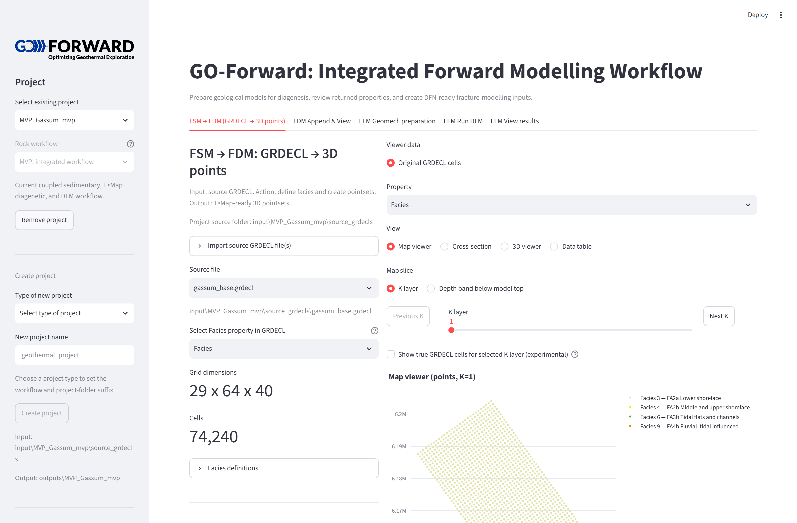
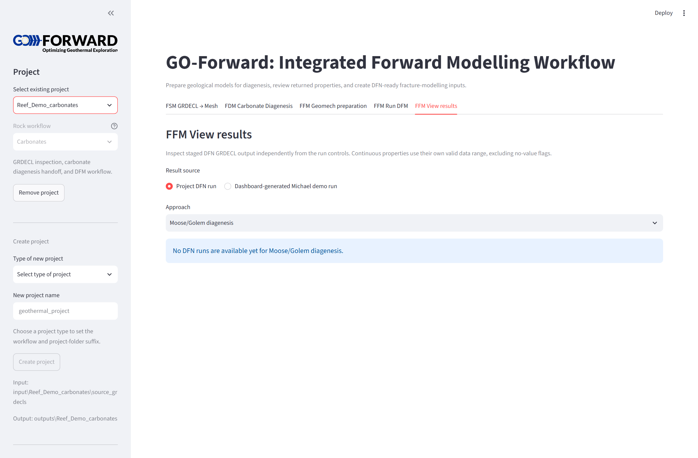
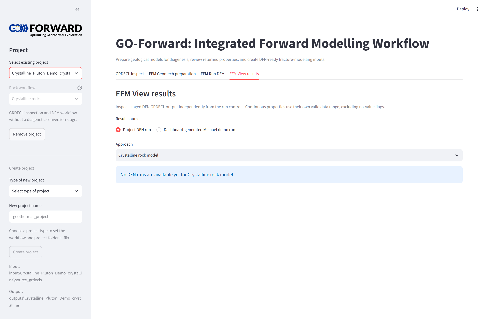

# Project Profiles & Architecture

GO-Forward organizes input models and output artifacts by project. Each project directory under `data/<project-name>/` contains a `project_config.json` defining its geological profile.

```text
data/
└── <project-name>/
    ├── project_config.json            # Profile selection & metadata
    └── 0_original_grdecl/             # Input GRDECL realization files
        ├── *.grdecl
        └── facies_config.json         # Facies/Rock-type labels and colors
```


---

## The Three Workflow Profiles

| Profile | Domain / Use Case | Diagenesis Stage | Mechanical Classification |
| :--- | :--- | :--- | :--- |
| **Siliciclastics (MVP)** | Sandstones, shales, deltaic systems (e.g. Gassum Fm) | T>Map 3D point set roundtrip (Best-fit, Union, Control, Uber) | Facies-based critical porosity / shale compaction |
| **Carbonates** | Reef complexes, shoals, carbonate platforms | Direct DionisosFlow mineralogy or reactive transport handoff | Carbonate rock physics & boundstone frameworks |
| **Crystalline rocks** | Granite plutons, basement gneisses, shear zones | Skipped (diagenesis not applicable) | Direct `RockType` / `Lithology` assignment |

---

## Project Configuration Format

`project_config.json` records the active rock profile:

```json
{
  "project_name": "MVP_Gassum_mvp",
  "workflow_profile": "Siliciclastics (MVP)",
  "workflow_suffix": "mvp"
}
```

When switching projects in the Streamlit dashboard sidebar, the dashboard dynamically adapts the visible tabs:
- For **Siliciclastics**, Tabs 1–3 expose the full T>Map export and append pipeline.
- For **Carbonates**, Tabs 1–3 present finite-element mesh preparation and mineralogy imports.
- For **Crystalline Rocks**, diagenesis tabs are hidden, routing directly from rock classification to geomechanics and fracture modeling.

### Siliciclastics Profile (Gassum Formation)


### Carbonates Profile (Reef Demo)


### Crystalline Profile (Pluton Demo)


