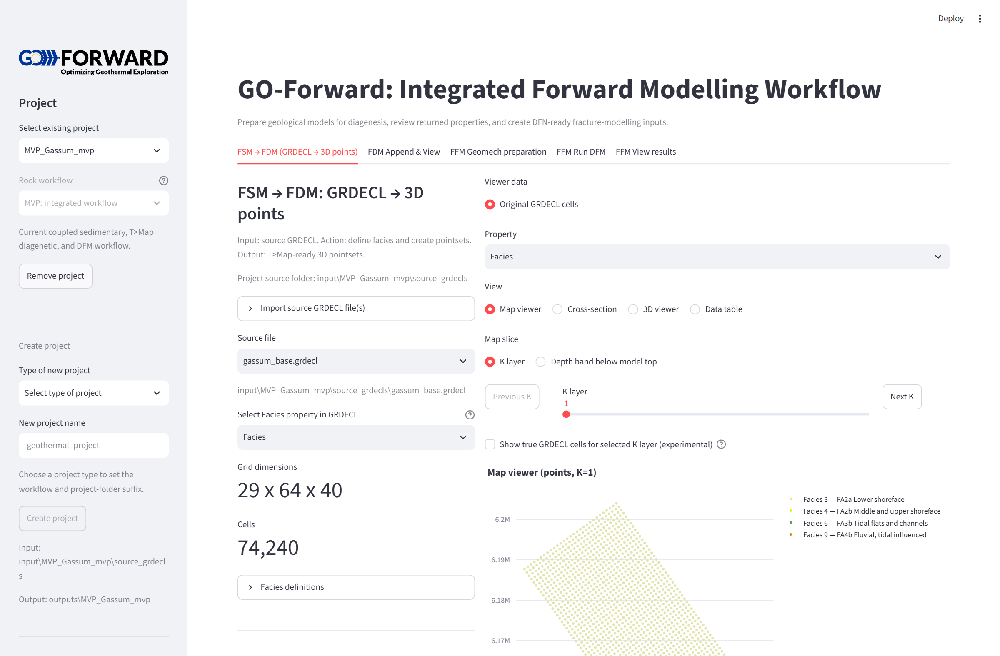

# Quickstart & Installation

This guide walks through setting up the Python environment using `uv`, recreating demonstration outputs, and launching the Streamlit dashboard.

---

## 1. Environment Setup with `uv`

The project requires Python 3.12+ and uses `uv` for fast, reproducible dependency management.

```powershell
# Clone or navigate to the repository
cd go-forward

# Synchronize the virtual environment with all optional dependencies (dashboard, docs, test)
uv sync --all-extras
```

Alternatively, if using standard `pip`:

```powershell
python -m venv .venv
.\.venv\Scripts\Activate.ps1
python -m pip install -r requirements-dashboard.txt
```

---

## 2. Launching the Interactive Dashboard

To start the Streamlit dashboard:

```powershell
uv run python run_dashboard.py
```

Once started, open the local URL in your browser (typically `http://localhost:8501`).




---

## 3. Rebuilding Synthetic Demo Outputs

The repository includes a batch launcher to recreate the synthetic diagenesis point sets and augmented GRDECLs across all four approaches:

```powershell
# Rebuild all four approaches for the default MVP Gassum project
uv run python regenerate_synthetic_outputs.py

# Rebuild only one specific approach (e.g. Control)
uv run python regenerate_synthetic_outputs.py --approach Control

# Dry-run inspection without writing files
uv run python regenerate_synthetic_outputs.py --dry-run
```

---

## 4. Serving the Documentation Locally

To preview this documentation locally with live-reload:

```powershell
uv run mkdocs serve
```

Open [http://localhost:8000](http://localhost:8000) to browse the interactive documentation.

To build the static HTML site:

```powershell
uv run mkdocs build --strict
```
