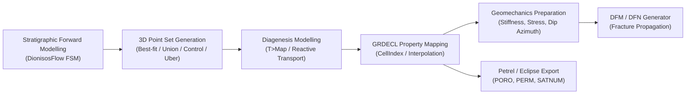
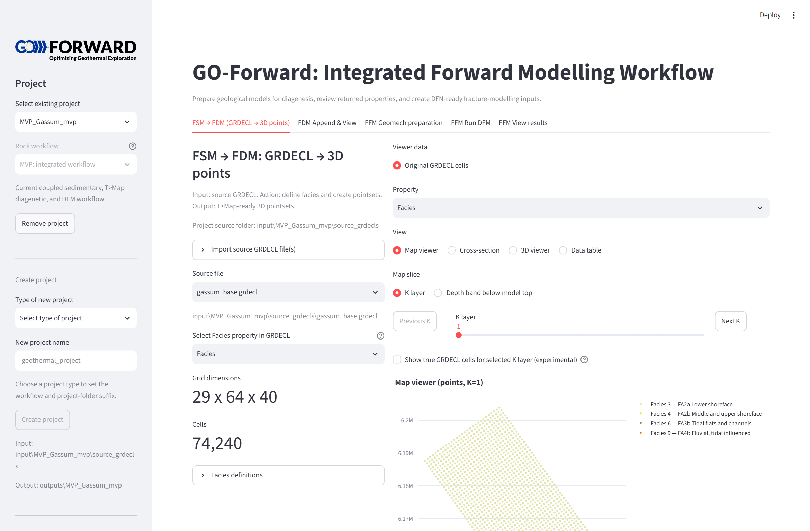

  

  

# GO-Forward: Integrated Geoscience Workflow

**GO-Forward** provides an end-to-end, reproducible scientific modelling chain connecting Stratigraphic Forward Modelling (DionisosFlow/Eclipse GRDECL), Forward Diagenesis Modelling (T>Map / Touchstone / Geocosm), empirical geomechanical property derivation, and Discrete Fracture Network (DFN / DFM) generation via Michael Welch's `DFMGenerator_GRDECL.exe`.

---

## Core Capabilities

- **Multi-Realization Uncertainty Handling:** Four alternative realization strategies (**Best-fit**, **Union**, **Control**, and **Uber**) tailored to computational budgets and uncertainty envelopes.
- **Dynamic Facies Discovery:** Automatic discovery of integer facies and rock-type codes with project-specific labels, colors, and diagenetic metadata.
- **Three Geological Profiles:**
    - **Siliciclastics (MVP):** Full T>Map diagenesis loop and empirical geomechanics.
    - **Carbonates:** Stratigraphic boundstone/packstone models with diagenetic handoffs.
    - **Crystalline Rocks:** Direct rock-type lithological mapping to DFM fracture modeling.
- **Interactive Streamlit Dashboard:** Visual 2D/3D map and cross-section inspection, facies editor, K-layer meshes, DFN configuration builder, and live process runner.
- **Batch Scripting & CI:** Python CLI scripts and automated pytest testing suite for reproducible pipeline execution.

---

## Quick Navigation

- [Quickstart & Installation](getting_started/quickstart.md): Environment setup with `uv` and launching the dashboard.
- [Project Profiles](getting_started/profiles.md): Understanding the Siliciclastics, Carbonates, and Crystalline profiles.
- [Siliciclastics Workflow](workflows/siliciclastics.md): Detailed FSM $\to$ T>Map $\to$ DFM modelling steps.
- [Carbonates Workflow](workflows/carbonates.md): Carbonate reef models and reactive diagenesis handoffs.
- [Crystalline Rocks Workflow](workflows/crystalline.md): Pluton and shear-zone fracture models.
- [Scripts Reference](api/scripts_reference.md): Command-line options and utilities reference.
- [Testing & Verification](developer/testing.md): Running the `pytest` test suite and adding background tests.
