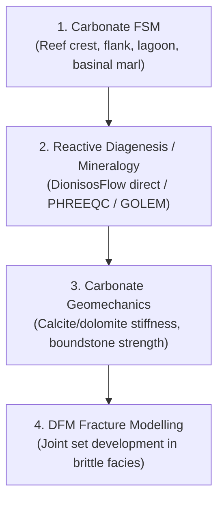

# Carbonates Workflow

The carbonates profile addresses complex biogenic reef frameworks, platform grainstones, and lagoonal wackestone-mudstone successions.



---

## 1. Carbonate Facies & Grid Models

Carbonate models typically exhibit pronounced spatial heterogeneity, steep reef margin geometries, and early cementation:

- **1: Reef Crest Framework Boundstone:** Rigid skeletal framework with high primary permeability.
- **2: Reef Flank Grainstone-Packstone:** High-energy skeletal debris with moderate-to-high porosity.
- **3: Back-Reef Lagoonal Wackestone:** Low-energy muddy carbonates.
- **4: Fore-Reef Slope Packstone:** Slump and breccia deposits.
- **5: Basinal Mudstone-Marl:** Deep-water low-permeability marls.

Demonstration grids can be generated with:
```powershell
uv run python scripts/create_demo_grdecl_projects.py
```


---

## 2. Diagenetic Handoffs & Mineralogy

Unlike siliciclastic systems where quartz cementation dominates burial diagenesis, carbonate diagenesis includes:
- Early marine cementation and micritization.
- Meteoric dissolution and karstification.
- Dolomitization and burial recrystallization.

In the GO-Forward workflow, mineralogical volumes (calcite, dolomite, anhydrite, clay) and porosity fields can be:
1. **Directly Imported:** Sourced from DionisosFlow multi-mineral outputs.
2. **Reactive Diagenesis Handoff:** Prepared for finite-element geochemical simulators (e.g. PHREEQC, GOLEM) and re-appended to the authoritative GRDECL.

---

## 3. Geomechanical Calibration & Fracture Modeling

Carbonate mechanical behavior is parameterized using mineral-specific elastic moduli ($E_{\text{calcite}} \approx 70 - 80\text{ GPa}$, $E_{\text{dolomite}} \approx 90 - 110\text{ GPa}$) and calibrated critical porosity envelopes. Brittle reef crest and flank grainstones are predisposed to earlier jointing compared to ductile basinal marls.
