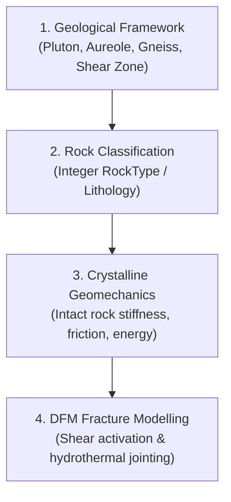

# Crystalline Rocks Workflow

The crystalline rocks profile targets igneous intrusive complexes, metamorphic basements, and hydrothermal fracture/shear zones for deep geothermal and critical mineral exploration.

---

## 1. Geological Framework & Rock Types

Crystalline environments skip porous sedimentary burial diagenesis entirely. The workflow models rock mechanics and tectonic fracture networks directly across lithological domains:

- **1: Granite Pluton:** Low matrix porosity, high Young's modulus ($E \approx 50 - 70\text{ GPa}$), high tensile strength.
- **2: Contact Metamorphic Aureole:** Thermally altered hornfels/skarn with anisotropic jointing.
- **3: Gneissic Basement Host Rock:** Foliated regional metamorphic host rock.
- **4: Fractured Shear Zone:** Tectonically damaged zone with enhanced permeability and reduced stiffness.

---

## 2. Direct Geomechanical Parameter Assignment

In Tab 4 of the dashboard, mechanical parameters are directly mapped per integer `RockType` or `Lithology` code:
- Reference Young's Modulus ($E_{\text{ref}}$ in GPa).
- Poisson's Ratio ($\nu$).
- Friction Coefficient ($\mu$) and Cohesion ($C$).
- Critical Fracture Energy ($G_c$ or $K_{Ic}$).
- In-situ stress gradients and fluid pressure.

---

## 3. DFM Generator Execution

The generated `YoungsModulus_Pa`, `PoissonsRatio`, `FrictionCoefficient`, and `FractureEnergy_J_m2` properties are ingested by `DFMGenerator_GRDECL.exe` to simulate natural fracture networks under regional far-field tectonic stress regimes.
