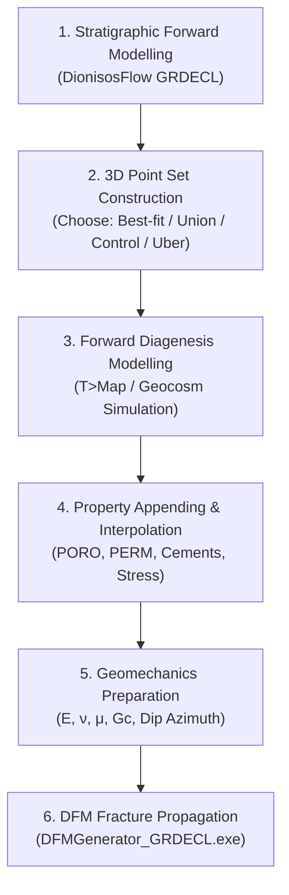
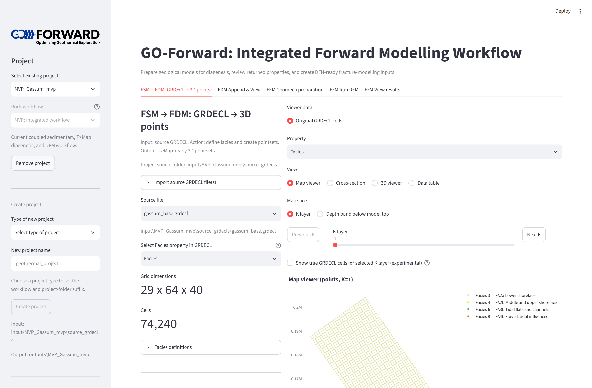
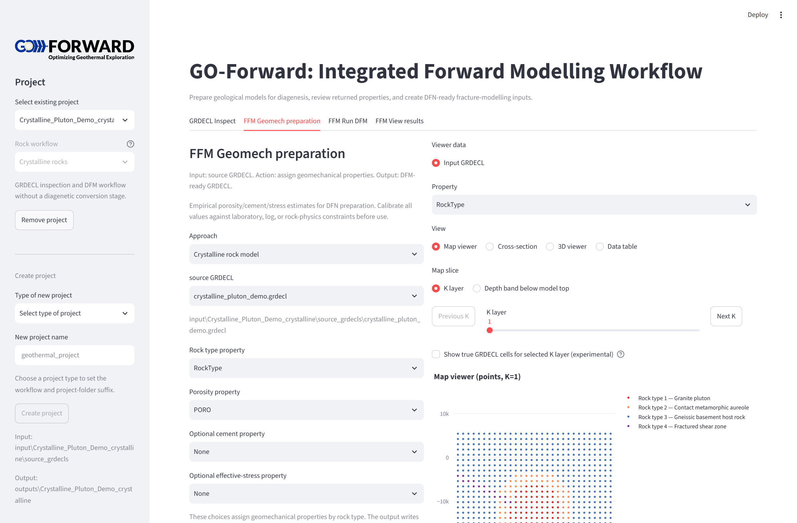
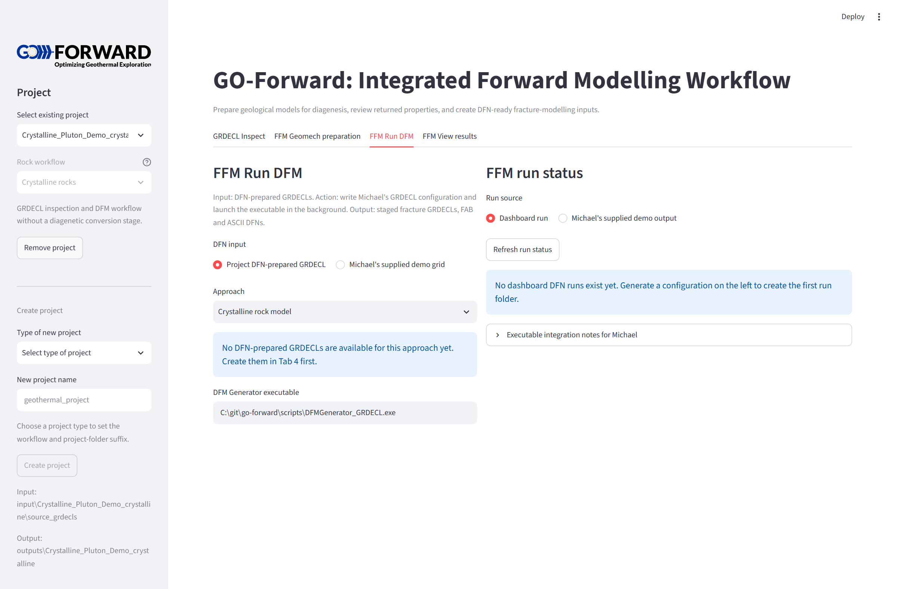

# Siliciclastics Workflow (FSM $\to$ T>Map $\to$ DFM)

The siliciclastics workflow models the evolution of clastic reservoirs from depositional basin filling through diagenesis to tectonic fracturing.

---

## 1. Stratigraphic Forward Modelling (FSM)

Source models originate as DionisosFlow 3D basin grids exported in Eclipse corner-point `.grdecl` format. Each model must contain:
- `SPECGRID`: Grid dimensions ($N_X, N_Y, N_Z$).
- `COORD`: Pillar line coordinates.
- `ZCORN`: Corner depths (positive depth in GRDECL; elevation $Z < 0$ in visualization).
- `MAPAXES`: Coordinate transformation from local grid to projected world coordinates.
- `FACIES`: Numeric integer facies code per cell.

---

## 2. Diagenesis Modelling Approaches (T>Map)

GO-Forward provides four alternative strategies to bridge the source grids to T>Map:

| Approach | Description | Use Case | Append-back Method |
| :--- | :--- | :--- | :--- |
| **Best-fit** | Direct cell-center export for each realization independently. | High-resolution single realization runs. | Exact `CellIndex` matching. |
| **Union** | Aggregates all actual facies cells across all realizations into one file per facies. | Full-fidelity multi-realization diagenesis. | Exact lookup by `Realization` and `CellIndex`. |
| **Control** | Extracts a shared top/bottom facies envelope per $(I, J)$ column across realizations with regular vertical controls. | Workload reduction while capturing the multi-realization facies envelope. | Vertical column interpolation into each realization. |
| **Uber** | Regular 3D grid lookup library per facies spanning the entire model depth. | Reusable diagenesis library across future realizations. | 3D vertical interpolation. |

---

## 3. Geomechanical Parameter Preparation

Before launching discrete fracture network growth, empirical rock-physics formulas translate porosity, cement fractions, and effective stress into linear elastic and fracture mechanics properties.

### Clean Sandstone & Carbonate Critical Porosity Model
Based on critical porosity rock physics (Nur et al., Mavko et al.):

$$E = E_{\text{ref}} \left(\max\left(0, 1 - \frac{\phi}{\phi_c}\right)\right)^m \left(1 + c_f C_{\text{cement}}\right) \left(1 + s_f \frac{\sigma'}{\sigma'_{\text{ref}}}\right)$$

- $\phi$: Total porosity (fraction).
- $\phi_c$: Critical porosity ($\sim 0.38 - 0.42$).
- $m$: Porosity exponent.
- $C_{\text{cement}}$: Volume fraction of quartz/carbonate cement.
- $\sigma'$: Effective stress (MPa).

### Shale Compaction & Stiffening Model
Empirical exponential stiffening with porosity reduction:

$$E = E_{\text{ref}} e^{-m \phi}$$

### Top-Horizon Dip Azimuth Calculation
Local down-dip azimuth $\theta$ is derived by fitting a Gaussian-weighted local plane to the model-top depth:

$$\theta = \text{atan2}\left(\frac{\partial z_{\text{depth}}}{\partial x}, \frac{\partial z_{\text{depth}}}{\partial y}\right) \pmod{360^\circ}$$

---

## 4. DFM / DFN Fracture Modelling

The geomechanically prepared GRDECL is passed to Michael Welch's `DFMGenerator_GRDECL.exe`. The generator models subcritical fracture propagation, layer-bound joint development, and regional tectonic deformation episodes:

1. **Subgrid Cropping:** Generates structurally complete, smaller test grids using `crop_grdecl.py` to accelerate testing.
2. **Execution:** Launched via `scripts/run_dfn_generator.py` with real-time stdout streaming and status tracking in `run_status.json`.
3. **Outputs:** Produces fracture network geometry (`.fab` files) and upscaled equivalent continuous fracture properties (`PERMX`, `PERMY`, `PERMZ`, `P32`, `P33`).

